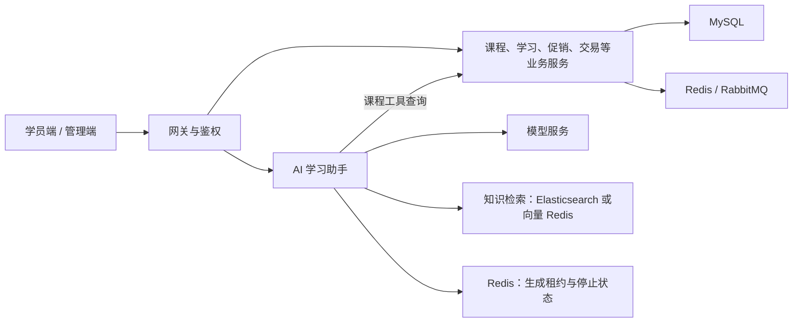

# 天机学堂 · Tianji

**在线学习平台后端，集成 AI 学习助手、课程导购与知识库问答。**

基于天机学堂课程项目持续扩展，使用 Java 17、Spring Boot 3 和 Spring AI，涵盖课程、学习互动、积分、优惠券及交易等业务。

[核心设计与源码](docs/project-highlights.md) · [文档导航](docs/README.md) · [运行配置](docs/public-setup.md) · [验证记录](docs/public-release-validation.md)

## 功能场景

| 场景 | 用户操作 | 后端处理 |
| --- | --- | --- |
| 课程导购 | 描述学习基础和目标，继续追问推荐课程 | 查询真实课程信息，核实详情，返回文字与课程卡片，并结合历史处理追问 |
| 知识库问答 | 在指定知识库会话中询问平台规则 | 在服务端授权的文档范围内检索，组织上下文后生成回答 |
| 流式对话 | 逐步接收回答，点击停止后继续交流 | SSE 输出、生成租约、停止信号与部分回答保存协同处理 |
| 学习积分 | 签到、参与学习互动、查看月榜 | 业务键去重、持久化待办与 Redis 排行榜同步 |
| 异步领券 | 领取或兑换优惠券，查询异步处理结果 | 持久化请求、幂等重放、事务内校验和发券；需显式启用 |

本仓库提供后端源码；前端独立维护。课程导购和长期记忆的历史演示步骤可从[文档导航](docs/README.md)查阅。

## 个人开发与改进

课程项目提供在线学习平台的业务基础。以下是本项目重点扩展和改进的方向，具体实现与取舍见[核心设计说明](docs/project-highlights.md)。

| 方向 | 解决的问题 | 主要实现 |
| --- | --- | --- |
| AI 学习助手与课程导购 | 将学习咨询、选课和知识库问答接入现有业务 | 意图路由与分支工具隔离、课程详情核实、课程卡片、授权范围内的 RAG 检索 |
| 跨实例对话协调 | 同一会话重复生成、停止请求落到其他实例、旧请求误释放新占位 | Redis Lua 原子占位、请求归属校验、租约续期与停止状态检查 |
| 积分与优惠券可靠处理 | 数据库与外部系统短暂故障、重复消息、重复提交导致状态不一致 | 积分持久化待办与业务幂等；优惠券请求表、RabbitMQ 通知、行锁和事务内结果更新 |

另外提供会话管理、可配置消息存储、用户长期记忆及提示词配置能力，详见 [AI 模块说明](tj-aigc/README.md)、[消息存储](tj-aigc/memory-storage.md)和[长期记忆设计](docs/aigc-long-term-memory-v1.md)。

## 核心设计与源码入口

可以从下面四个问题开始阅读，每条路线都附有对应测试：

| 想了解的问题 | 实现入口 | 测试入口 |
| --- | --- | --- |
| 一条提问如何进入课程推荐、咨询或知识分支？ | [AgentDispatcher](tj-aigc/src/main/java/com/tianji/aigc/agent/AgentDispatcher.java) | [AgentWorkflowTest](tj-aigc/src/test/java/com/tianji/aigc/agent/AgentWorkflowTest.java) |
| 为什么旧请求不能释放新一轮生成占位？ | [ChatGenerationStore](tj-aigc/src/main/java/com/tianji/aigc/service/ChatGenerationStore.java) | [ChatRedisCoordinationTest](tj-aigc/src/test/java/com/tianji/aigc/service/ChatRedisCoordinationTest.java) |
| 积分明细写入后，排行榜更新失败如何补偿？ | [PointsMessageServiceImpl](tj-learning/src/main/java/com/tianji/learning/service/points/impl/PointsMessageServiceImpl.java)、[PointsMessagePublishTask](tj-learning/src/main/java/com/tianji/learning/task/PointsMessagePublishTask.java) | [PointsMessageTransactionTest](tj-learning/src/test/java/com/tianji/learning/service/points/PointsMessageTransactionTest.java) |
| 异步领券如何处理重复消息和事务回滚？ | [CouponClaimProcessor](tj-promotion/src/main/java/com/tianji/promotion/service/claim/CouponClaimProcessor.java) | [CouponClaimTest](tj-promotion/src/test/java/com/tianji/promotion/service/impl/CouponClaimTest.java) |

测试文件用于说明覆盖的行为；`ChatRedisCoordinationTest` 需要带测试标记的独立 Redis，未配置时会跳过。公开版本实际执行过的检查以[验证记录](docs/public-release-validation.md)为准。

## 整体架构与技术栈



| 类别 | 技术 |
| --- | --- |
| 后端 | Java 17、Spring Boot 3.5.16、Spring Cloud 2025.0.3、Spring Cloud Alibaba 2025.0.0.0 |
| 数据与中间件 | MyBatis Plus、MySQL、Redis、RabbitMQ、Nacos、Elasticsearch |
| AI | Spring AI 1.1.8、DeepSeek 兼容接口、SSE、工具调用、RAG |
| 可选能力 | MongoDB 消息存储、独立 Redis 向量存储、课程 MCP 服务 |

具体版本与依赖以各模块 `pom.xml` 为准。

<details>
<summary>完整业务模块</summary>

| 模块 | 内容 |
| --- | --- |
| `tj-gateway` / `tj-auth` / `tj-user` | 网关、登录鉴权、用户 |
| `tj-course` / `tj-media` / `tj-search` | 课程、媒资、搜索 |
| `tj-learning` / `tj-remark` | 学习、互动问答、积分与排行榜、点赞 |
| `tj-promotion` | 优惠券、兑换码、领取与发放 |
| `tj-trade` / `tj-pay` | 交易、支付及独立的沙箱试验能力 |
| `tj-exam` / `tj-data` / `tj-message` | 考试、数据、消息 |
| `tj-aigc` | AI 对话、课程导购、RAG、会话与记忆 |
| `tj-course-mcp` | 可选课程 MCP 服务，通过 `mcp-pilot` profile 构建 |
| `tj-common` / `tj-api` | 公共组件、内部接口 |

</details>

## 构建与运行

需要 JDK 17 和 Maven 3.8+：

```shell
mvn -DskipTests package
# 同时构建可选课程 MCP 模块
mvn -P mcp-pilot -DskipTests package
```

运行前按[配置说明](docs/public-setup.md)准备基础设施、业务表和 Nacos 配置，再以 `local` profile 启动所需模块。环境变量见 [.env.example](.env.example)，需在 IDE、终端或部署平台注入；Spring Boot 不会自动读取根目录 `.env`。

公开源码不包含完整初始化数据库、运行密钥和前端，启动整个平台需要补齐对应资源。更详细的接口、配置与阅读路线见[文档导航](docs/README.md)。

## 验证记录与已知限制

2026-11-06 公开副本验证：JDK 17 下 29 个 Maven 模块构建通过，包含测试源码编译；定向测试 3 项通过，16 项真实基础设施及支付测试因开关未启用而跳过。完整命令和检查范围见[公开版本验证记录](docs/public-release-validation.md)。

- 历史真实模型、浏览器及开发库联调记录按日期保留，不代表对公开副本重新完成了相同验收；原始输出未全部随源码公开。
- 尚未对公开副本完成整个平台启动与真实外部服务验收；沙箱支付记录不等于正式订单支付及课程开通验收。
- 异步领券默认关闭，需建表和显式启用；它采用数据库行锁发券，尚无秒杀级吞吐验证。RAG 的 rerank 等可选能力也需按配置启用。
