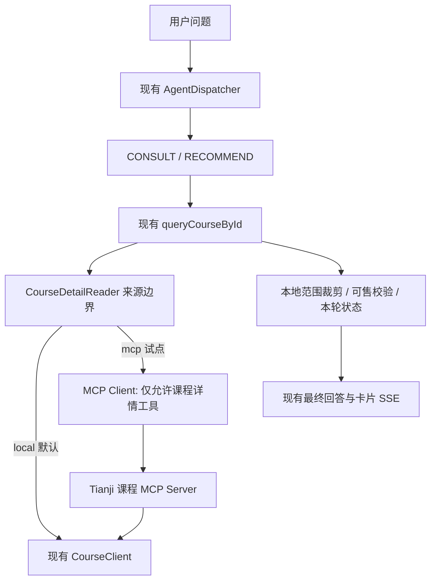

# 天机学堂 MCP 方案适配分析与改造计划

日期：2026-10-26。审计基线：`feature-aigc`，`6c6bd02`。

浏览器试点进度（2026-10-27）：现有聊天页面已加入独立试点入口，当前构建四条自然问法真实验收通过，覆盖两门课、两课对比和同会话深度追问。页面问答、历史恢复、停止、MCP 不可用提示及退出/重新进入已验证；详见 [浏览器试点验收](mcp/browser-pilot-2026-10-27.md)。日常服务总开关未切换。

独立试点进度（2026-10-27）：已开放 [启动、检查、问答、停止入口](../scripts/mcp-pilot/README.md)，实际运行与冒烟记录见 [试点记录](mcp/pilot-2026-10-27.md)。自然课程事实问句的误路由已作程序保护，原问句真实复验通过；日常总开关仍未切换。

状态更新（2026-10-27）：[两门课程、六条真实功能验收通过](mcp/fact-live-acceptance-2026-10-27.md)，实际 MCP 详情读取 4 次，固定正文、卡片和历史核对通过；测试会话与临时进程已清理，可进入独立试点，日常总开关尚未切换。

最新本地进度：已实现 [确定性课程事实回答](mcp/fact-answers-2026-10-26.md)，相关回归 191 项和原三个失败问题快照回放通过；未部署或启用 MCP。

后续进度：资料裁剪语义和名称范围判断已修正，相关回归 100 项通过；内容复验及候选资料越界的处理见 [内容修正记录](mcp/content-fix-2026-10-26.md)。MCP 继续默认关闭。

状态更新（2026-10-26）：P0/P1 代码及受控范围内的真实模型工程验收已完成，最终相关回归 198 项全通过；内容验收未通过，仍默认关闭，见 [真实模型验收](mcp/acceptance-2026-10-26.md)。原 10 秒整轮预算实测不足，已调整为 20 秒，单操作仍为 5 秒；两项历史 Redis 测试已修正故障注入时机并在同版独立 Redis 上通过。以下“本轮”保留原计划审计阶段的历史语义，不表示当前仍未实施。P2 仍需另行确定实际需求，不在本次范围。

## 1. 结论与范围

原方案的方向适合项目：保留 Spring AI、现有 Agent 分工、RAG、聊天记忆和 SSE，在工具边界渐进接入 MCP。但原方案还不能直接作为施工清单，主要需要调整场景优先级、保留课程请求内状态、处理框架默认行为，并复用已经存在的观测能力。

建议采用以下路线：

1. **P0：验证 Client 与一个只读工具的协议闭环。** 使用可控测试 MCP Server，验证初始化、发现、调用、失败隔离和取消。测试替身不能作为真实业务验收。
2. **P1：课程详情只读试点。** 将现有 `queryCourseById` 的基础详情读取切换为可选 MCP 来源；模型看到的工具名、参数与课程卡片流程保持兼容。配套一个只提供课程详情的 Tianji MCP Server，不建设通用业务网关。
3. **P2：按实际需求扩展。** 再选择 GitHub 课程代码答疑、个人学习进度或其他外部工具，并在出现多个工具来源后扩展统一注册与授权。工单写入另立业务需求。

这与输入方案“外部 Client → GitHub/工单 → 自建 Server”的顺序有所不同：当前没有已核实的课程代码仓库映射和工单系统，课程查询却已有完整服务接口和回归测试。为了让首个真实闭环可验证，将一个极小的自建只读 Server 提前；Client 的协议验证仍先完成。

如果目的只是让当前一个 AI 客服调用课程接口，保留 Java Tool + Feign 更简单。MCP 试点验证的是标准协议接入和未来复用价值，不预设能提升准确率、速度或降低 Token。没有复用需求时，可以停在 P0，不扩大生产架构。

### 首期明确边界

- 保留 Java 17、Spring Boot 3.5.16、Spring AI 1.1.2，不顺带升级框架。
- 不新增 Agent 类型，不改路由提示词，不给 ROUTE、KNOWLEDGE 增加 MCP 工具。
- 不改 RAG 检索、索引、改写、重排、证据回答或 ChatMemory 算法。
- 保留 SSE 事件类型及载荷结构；必要的 MCP 错误使用现有 ERROR 事件承载新业务错误码。
- 不开放下单、退款、创建工单、保存计划等写操作，不增加前端确认流程。
- 不把 `CourseTools` 整体远程化，不把全部 Feign 接口自动生成 MCP 工具。
- 新功能默认关闭；关闭后不依赖 MCP 服务和凭据。

## 2. 当前项目核验结果

以下是代码事实，不代表当前运行实例已启用相应配置，也不替代真实环境联调。

| 领域 | 已核实事实与源码 | 对接入的影响 |
| --- | --- | --- |
| 依赖与 Web 栈 | 根 `pom.xml` 管理 Boot 3.5.16、AI 1.1.2、Java 17；`tj-aigc/pom.xml` 使用 MVC Web Starter 和 Reactor；尚无 MCP 依赖 | 可增加同版本 MCP Client；Flux 输出并不要求把应用迁移成 WebFlux |
| 路由 | `AgentDispatcher` 每轮只执行一个业务 Agent；有知识库过滤条件的会话直接进入 KNOWLEDGE；路由超时 15 秒 | 外部工具不会因为“注册成功”自动加入某个业务流程 |
| 工具白名单 | RECOMMEND：`browseCourses`、`searchCourses`、`searchCoursesByGoal`、`queryCourseById`、`recommendCourses`；CONSULT：`searchCourses`、`queryCourseById` | 首期沿用两份白名单；语义搜索仍受可用性条件控制 |
| 请求组装 | `AbstractAgent` 为本轮传入 `CourseRecommendations` 和 Agent 类型，显式设置工具回调 | 这里的 Java 对象不能直接作为远程调用上下文传出 |
| 工具执行 | `CourseToolPreparationAdvisor` 调用模型并由 `ToolCallingManager` 执行工具，最多 8 个执行轮次；最终答案另行流式生成，工具回调清空 | 可复用既有执行入口；八轮上限不是网络超时，也不提供去重保证 |
| 推荐状态 | `CourseTools` 更新本轮候选、查询标记、详情核实状态和卡片；`recommendCourses` 再核实可售状态及价格 | 应在本地维护这些状态；单纯改用远程回调会破坏推荐约束 |
| 取消与会话 | `ChatServiceImpl` 使用 Redis 生成占位、续租、停止信号、响应式取消和部分回答保存；`AgentContext` 提供 active/ownsGeneration | 必须区分停止输出、停止后续工具调用与真正中止远程执行 |
| RAG | 已有 `KnowledgeRetrievalPipeline`、BM25/向量检索、RRF、可选 rerank、上下文选择与失败处理 | 当前已超出早期纯向量基线；MCP 不应把这些能力重新实现一遍 |
| 可观测性 | 已有整轮 `chat.request` Observation、RAG 阶段观测、Langfuse OTLP 配置及测试 | 新增 MCP 子观测，复用父 trace；无需另建整套 Langfuse 接入 |
| 身份传递 | `ChatServiceImpl` 在调度前读取已归属会话；Feign 用户透传依赖 `UserContext` ThreadLocal | 不能假定 boundedElastic 或共享 MCP Client 上自动拥有请求用户身份 |

重点源码：

- [AgentDispatcher](../tj-aigc/src/main/java/com/tianji/aigc/agent/AgentDispatcher.java)、[AbstractAgent](../tj-aigc/src/main/java/com/tianji/aigc/agent/AbstractAgent.java)、[KnowledgeAgent](../tj-aigc/src/main/java/com/tianji/aigc/agent/KnowledgeAgent.java)。
- [CourseTools](../tj-aigc/src/main/java/com/tianji/aigc/tools/CourseTools.java)、[CourseRecommendations](../tj-aigc/src/main/java/com/tianji/aigc/tools/CourseRecommendations.java)、[工具准备 Advisor](../tj-aigc/src/main/java/com/tianji/aigc/tools/CourseToolPreparationAdvisor.java)。
- [ChatServiceImpl](../tj-aigc/src/main/java/com/tianji/aigc/service/impl/ChatServiceImpl.java)、[AgentContext](../tj-aigc/src/main/java/com/tianji/aigc/agent/AgentContext.java)、[Feign 用户透传](../tj-auth/tj-auth-resource-sdk/src/main/java/com/tianji/authsdk/resource/interceptors/FeignRelayUserInterceptor.java)。
- [RAG 流水线](../tj-aigc/src/main/java/com/tianji/aigc/knowledge/KnowledgeRetrievalPipeline.java)、[观测配置](../tj-aigc/src/main/java/com/tianji/aigc/config/RagObservabilityConfig.java)、[评测与 Langfuse 说明](rag-evaluation/README.md)。

## 3. 对输入方案的逐项判断

| 原建议 | 判断 | 本项目的具体处理 |
| --- | --- | --- |
| Client 先行、渐进引入 | 采纳 | 先做独立协议验证；不以“加 Starter 能启动”代替工具调用验收 |
| 保留 Agent、RAG、记忆、SSE | 采纳 | 首期通过课程详情的数据来源边界接入，避免改全局对话流程 |
| 合并本地与 MCP 工具注册 | 缩小首期范围 | 一个远程能力先藏在现有业务工具后；有第二类直接暴露给模型的外部工具时再引入轻量目录，避免先造通用框架 |
| GitHub 辅助答疑优先 | 后置 | 没有核实课程与仓库、版本、路径的映射；KNOWLEDGE 目前没有工具，知识库会话还受明确范围限制 |
| 客服工单优先；缺服务则建演示服务 | 不作为首期生产闭环 | 定向检索未发现工单领域实现；演示 Server 只能验证协议，不能向用户声称问题已提交真实客服 |
| 学习计划 MCP | 有业务基础，但需另行设计 | 已有学习进度和计划接口；现有计划是课程的每周学习频率，不是完整“三个月路线图”存储 |
| Web Search MCP | 按独立需求扩展 | 需要可信来源、引用和与内部事实的冲突规则；不是课程详情试点的依赖 |
| Client 稳定后才做 Tianji Server | 调整顺序 | P0 用测试 Server；P1 提前做一个真实课程详情 Server，避免被尚不存在的外部业务场景阻塞 |
| 工具治理、超时、授权、取消 | 采纳必要部分 | 首期落实单来源准入、参数/结果校验、元数据最小化、时间与并发上限；通用限流平台和写操作确认留到对应需求 |
| Langfuse 与对照评测 | 采纳并复用现有实现 | 添加工具子观测与专用问题集；不覆盖当前 RAG 评测基线，不预设 MCP 性能更优 |

### 后续业务接口的真实基础

- 课程：`CourseClient.getCourseBaseInfoById` 对应 `GET /course/{id}/baseInfo`；`getSimpleInfoList`、`getBaseInfoBatch` 已存在。`CourseBaseInfoDTO` 有课程名称、分单位价格、免费标记、月单位有效期、适用人群、介绍和目录标题。进一步核对 `CourseServiceImpl` 发现，单详情接口遇到不存在课程会抛通用 `BadRequestException(400)`，不能假定它返回 null 或 HTTP 404。
- 学习进度：`LearningClient.queryLearningRecordByCourse` 对应 `GET /learning-records/course/{courseId}`；`isLessonValid` 可查询当前用户有效课表。**其 fallback 会返回 null，未来封装前必须区分服务失败与无记录，不能解释成“尚未学习”。**
- 学习计划：`LearningLessonController` 已有 `POST /lessons/plans`、`GET /lessons/plans`；服务实现按用户与课程归属更新 `weekFreq`。现有 `LearningClient` 尚未暴露计划操作。
- 订单：`TradeClient.checkMyLesson` 能检查当前用户是否报名课程；不能据此声称已有完整播放诊断或工单能力。
- GitHub 与工单：本轮定向代码检索未发现对应业务集成；是否有仓库外系统仍需核实，不能断言组织中不存在。

参考：[CourseClient](../tj-api/src/main/java/com/tianji/api/client/course/CourseClient.java)、[LearningClient](../tj-api/src/main/java/com/tianji/api/client/learning/LearningClient.java)、[LearningClientFallback](../tj-api/src/main/java/com/tianji/api/client/learning/fallback/LearningClientFallback.java)、[LearningLessonController](../tj-learning/src/main/java/com/tianji/learning/controller/lesson/LearningLessonController.java)、[TradeClient](../tj-api/src/main/java/com/tianji/api/client/trade/TradeClient.java)。

## 4. Spring AI 1.1.2 兼容性与风险

本轮按官方 **v1.1.2 标签源码** 核对，不能把当前 `/reference/1.1/` 文档中的新增属性都视为 1.1.2 已支持。以下是源码可确认的行为，尚未在本项目新增依赖后编译或联调。

| 项目 | 证据与结论 | 计划约束 |
| --- | --- | --- |
| Client 依赖 | 该版本有 `spring-ai-starter-mcp-client`，引入 HttpClient 自动配置及 MCP 支持 | 首选该 Starter，由现有 BOM 管理版本；不额外引入另一套 AI 框架 |
| SDK 版本 | v1.1.2 父 POM 中 `mcp.sdk.version=0.17.0` | 实施时检查有效依赖树；不单独强制升级底层 SDK |
| 执行方式 | `SyncMcpToolCallback` 实现 `ToolCallback`；项目已有同步工具准备并调度至 boundedElastic | 首期选择 SYNC；不因客户端接入迁移 Web 栈；并发占用需要实测 |
| 启动依赖 | Client 默认启用、默认初始化，自动配置在创建 Client 时调用 `initialize()`；默认请求超时 20 秒 | 显式默认关闭；采用受控延迟初始化，不能让远程宕机阻塞整个应用启动 |
| 工具准入 | 默认 MCP 工具过滤器允许全部工具；名称前缀机制不能代替业务授权 | 禁止把发现结果无条件注册为全局默认工具；只选择固定来源与固定原始工具名 |
| 元数据 | `ToolContextToMcpMetaConverter.defaultConverter()` 排除 exchange 项与 null 后，将其他上下文条目放入 MCP meta | 首期调用不传整份 ToolContext；若使用回调桥接则设置 `noOp()` 或严格允许列表，避免传出 CourseRecommendations、DetailScope 等对象 |
| 结果与错误 | 同步回调将 `response.content()` 序列化为 JSON；`isError=true` 转成工具执行异常 | 不把原始返回字符串直接当作业务 DTO；固定内容类型与契约并测试；异常需在本地转成安全状态 |

远程通信首选 Streamable HTTP；客户端和 Server 必须共同验证协议兼容。面向用户的 SSE 是现有聊天输出协议，与 MCP 的传输协议分别管理，不改 SSE 事件格式。[MCP 传输规范](https://modelcontextprotocol.io/specification/2025-06-18/basic/transports)

来源：[v1.1.2 Client Starter](https://github.com/spring-projects/spring-ai/blob/v1.1.2/spring-ai-spring-boot-starters/spring-ai-starter-mcp-client/pom.xml)、[父 POM](https://github.com/spring-projects/spring-ai/blob/v1.1.2/pom.xml)、[Client 属性](https://github.com/spring-projects/spring-ai/blob/v1.1.2/auto-configurations/mcp/spring-ai-autoconfigure-mcp-client-common/src/main/java/org/springframework/ai/mcp/client/common/autoconfigure/properties/McpClientCommonProperties.java)、[Client 自动配置](https://github.com/spring-projects/spring-ai/blob/v1.1.2/auto-configurations/mcp/spring-ai-autoconfigure-mcp-client-common/src/main/java/org/springframework/ai/mcp/client/common/autoconfigure/McpClientAutoConfiguration.java)、[工具自动配置](https://github.com/spring-projects/spring-ai/blob/v1.1.2/auto-configurations/mcp/spring-ai-autoconfigure-mcp-client-common/src/main/java/org/springframework/ai/mcp/client/common/autoconfigure/McpToolCallbackAutoConfiguration.java)、[同步工具回调](https://github.com/spring-projects/spring-ai/blob/v1.1.2/mcp/common/src/main/java/org/springframework/ai/mcp/SyncMcpToolCallback.java)、[元数据转换器](https://github.com/spring-projects/spring-ai/blob/v1.1.2/mcp/common/src/main/java/org/springframework/ai/mcp/ToolContextToMcpMetaConverter.java)。

## 5. 首个真实闭环的设计

业务示例：“这门课程适合什么基础的人？目录包含哪些内容？”由现有 CONSULT 查询课程详情、根据真实结果回答，并沿用课程卡片。

### 5.1 工具与状态边界

- 模型继续调用 `queryCourseById(courseId)`。首期不把原始远程工具描述、参数或工具列表直接交给模型。
- 新增一个窄的 `CourseDetailReader` 来源边界：输入课程 ID 和仅限本地的请求范围对象，输出兼容 `CourseBaseInfoDTO` 的课程基础详情。local 实现继续调用原 `CourseClient.getCourseBaseInfoById`；mcp 实现调用固定远程工具并校验结果。
- 新增远程工具暂定名 `getCourseDetail`；由配置中的稳定 `serverId=course-catalog` 与原始工具名共同定位。模型工具名不受 SDK 自动前缀变化影响。
- `queryCourseById` 仍负责 ID 一致性检查、`DetailScope` 范围裁剪、`markQueried`、详情核实标记和详情卡片；`recommendCourses` 仍在本地复核候选与当前状态、价格。
- 首期只替换单课程基础详情读取。`browseCourses`、`searchCourses`、`searchCoursesByGoal` 的批量查询和语义检索继续使用原路径。因此不能把首期表述为“所有课程检索已迁移 MCP”。
- MCP Server 不持有本轮候选、不决定选哪几张卡片、不接触 ChatMemory、不构造 SSE。

请求范围拟命名为 `McpCallScope`，只保存 active/ownsGeneration 检查和本轮 MCP 的单调时钟截止时间。由 `AbstractAgent` 在每次请求订阅中创建，通过本地 ToolContext 到 `CourseTools`，再显式传给 reader；不修改共享 Client，不放进 MCP meta。预算不能在每次查询详情时重新计时。MCP 分支在远程返回后及写入详情核实/卡片前复查范围，包括后续本地可售查询返回后的检查。local 分支维持原路径；首期不为此新增 userId 参数或改变 `AgentContext` 的身份含义。

这里仍是完整 MCP 接入：Client 完成初始化与发现，校验远程工具契约后进行标准工具调用。保留本地业务工具外壳，是为了兼容现有请求状态；它没有实现面向模型的通用外部工具注册。

### 5.2 远程契约

采用版本化结果封装：`schemaVersion`、`status`、`data`。首期 `status` 至少区分 `FOUND`、`NOT_FOUND`；权限、超时、不可用和协议/解析错误走受控错误分类，不能伪装成 `NOT_FOUND`。

- `courseId` 跨协议使用十进制字符串，校验为正 Long 范围，避免大整数精度损失；回到业务层后恢复 Long。
- 数据只包含 `CourseBaseInfoDTO` 现有字段。价格保留整数“分”，有效期保留“月”，免费标记与缺失字段语义不变；最终面向模型的元单位转换继续在现有 `CourseInfo.of` 完成。
- 合同中固定一种可在 1.1.2/SDK 0.17.0 实测通过的返回方式，优先单个文本内容块承载 JSON，明确解析层级；不假定同步回调已自动处理 `structuredContent`。
- 设置返回体字节上限和目录项数上限，具体数值由正式课程样本确定；超过上限返回明确错误，不悄悄截断后声称拿到了完整目录。
- 服务失败不得返回空对象或 null 冒充不存在。Server 使用的 Feign fallback、异常映射与 HTTP 响应包装均须实测。

不存在的结果需要特别处理：当前单详情接口用通用 400 表达不存在，不能把所有 400 转成 NOT_FOUND，也不依赖异常文本猜测。Server 可复用现有 `getBaseInfoBatch(List.of(id))` 的单 ID 查询，以成功返回的空列表确认不存在；成功详情字段需与单详情接口做契约对照。这样会使远程“不存在”分支比现有 local 通用异常更明确，是需要单独记录和测试的边界差异；本期不顺带修改 local 对所有 400 的处理。若 P0/P1 无法证明空列表未经过吞异常的 fallback，则该状态保持查询失败，不能伪造 NOT_FOUND。

### 5.3 Server 交付范围

新增独立、可选的 `tj-course-mcp` 模块，使用与当前 BOM 一致的 MCP Server WebMVC 支持，并复用 `tj-api` 的受保护课程接口。依赖与传输配置需要在 P0 核对和编译，不从最新参考文档直接复制。

根工程拟通过 `mcp-pilot` Maven profile 加入该模块，避免默认构建、默认启动增加必需服务。Server 不加载 DeepSeek、聊天数据库或 RAG；不依赖 `tj-aigc` 整个模块。

首期仅本机或受保护内网可访问。Server 验证调用方身份和允许查询的课程范围；若尚未证明现有课程接口满足目录可见性边界，则试点先限定经确认的测试课程 ID 白名单。不能将内部基础详情接口直接等同于可对公网暴露的课程目录。对外服务化与全量课程开放另行验收。

### 5.4 选择 MCP 前后的可比性

local 与 mcp 由同一 `queryCourseById` 外壳调用，返回相同业务类型，使用相同模型工具定义、问题与课程序列。这样可以比较传输接入的增量成本，不把提示词、推荐规则或检索算法变更混进实验。

## 6. 配置、失败与取消策略

### 6.1 开关与初始化

以下是拟新增的业务配置，尚未实现；框架连接属性须在 P0 根据 1.1.2 实际绑定确认。

| 配置 | 建议默认值 | 行为 |
| --- | --- | --- |
| `tj.ai.mcp.enabled` | `false` | 关闭时只创建 local 读取路径，不建立 MCP 连接 |
| `tj.ai.mcp.course-detail-source` | `local` | 仅允许 local/mcp；enabled=false 时必须落回 local |
| `tj.ai.mcp.course-server-url` | 无 | 仅管理员配置，不接收模型或普通用户提供的地址 |
| `tj.ai.mcp.request-timeout` | `5s`，待实测 | 限制单次 MCP 操作；与连接超时、初始化超时分别核对 |
| `tj.ai.mcp.round-budget` | `10s`，待实测 | 本轮 MCP 初始化、发现、调用共享累计预算，不修改原有本地工具轮数 |
| `tj.ai.mcp.max-concurrent-calls` | 待压测确定 | 有界并发；满额时受控返回忙碌，不无限排队 |

框架层显式控制 `spring.ai.mcp.client.enabled`，并关闭 `spring.ai.mcp.client.toolcallback.enabled` 的自动工具提供者；首期使用显式连接与调用，不依赖全局注册。延迟初始化使用受控状态，初始化失败必须有界返回；`initialized=false` 本身不等于已经实现了故障恢复。

不同时配置相互独立的两套启用状态：实现时由业务开关决定 Client 创建和来源选择，测试覆盖配置组合。配置变更先按重启生效设计，不承诺现有构造期缓存的工具集合可以运行时热切换。

凭据来自仓库外配置，文档仅列环境变量名或占位符。认证参数不进工具 Schema、模型参数或 URL 查询串。首期不转发最终用户 Token 给第三方，也不把普通 meta 字段视为身份认证证明。

### 6.2 失败行为

| 状态 | 预期行为 |
| --- | --- |
| MCP 关闭或选择 local | 沿用原路径；远程未配置、不可达都不影响原客服启动与调用 |
| 已选 mcp，但初始化/发现失败 | 当前需要详情的调用返回受控错误；其他本地工具请求继续可用 |
| 远程超时/不可用 | 使用现有 ERROR 事件报告安全消息；建议业务码 `MCP_TOOL_TIMEOUT` / `MCP_TOOL_UNAVAILABLE`，保持事件结构不变 |
| 真正不存在 | 只有服务成功查询并明确返回 NOT_FOUND 时才进入未找到语义；回答仅描述本次查询，不推断全平台无课程 |
| 不允许的来源、工具或课程 | 调用前或 Server 端拒绝；不触发其他工具，不用空结果掩盖授权问题 |
| 返回 ID 不符、版本不支持、JSON 损坏或过大 | 受控协议错误，不更新详情核实标记和卡片 |

首期不开启自动重试，也不在 mcp 失败后隐式改调 local，便于确认真正经过了 MCP 并保持故障语义。通过切回 local 提供运维回退；后续如确需同源只读 fallback，应独立配置并记录实际来源。取消、权限拒绝、无结果不能触发 fallback。

### 6.3 取消承诺

当前同步准备循环只能在阶段边界检查取消，不能据此承诺远程方法被即时终止。首期要求：

1. 在初始化、发现、实际调用前检查本轮是否仍有效；调用返回后再次检查，再交回本地状态处理。
2. 停止或丢失生成归属后不再调用后续 MCP 工具，不写入迟到的卡片、候选或详情核实状态，不进入后续回答。
3. 尝试使用 SDK 可支持的请求取消；实际是否发送协议取消、是否中断网络等待由集成测试记录。无法中止的只读调用至多运行到明确超时，迟到结果丢弃。
4. 不能为取消一个请求而关闭其他请求复用的整个 Client；不能在共享 Client 中保存某个用户或某轮取消状态。
5. 保持现有停止后部分回答保存、Redis 占位释放与并发会话隔离。

未来写操作不能沿用“超时即失败”的简单结论：超时可能已执行，必须有幂等、状态查询和可信确认记录后再引入。本期不实现这些写操作。

## 7. 最小治理与观测

### 7.1 准入与上下文

- 只连接配置中一个固定 Server，发现列表只接受固定工具名与预期 Schema；未知工具、名称碰撞或 Schema 不兼容时拒绝接入，不让模型自行选择来源。
- 原 Agent 白名单继续限制本地业务工具；首期远程只有固定映射。未来有多个 MCP 来源时再建立 `serverId + originalToolName → modelToolName` 的稳定目录，名称冲突显式失败。
- `CourseRecommendations`、`DetailScope`、取消对象、会话历史、用户凭证等保持本地。可发送的追踪标识只取明确允许的非敏感字符串；不将整个 ToolContext 序列化。
- 首期没有个人学习数据调用。后续用户身份应在进入响应式调度前捕获，从可信请求上下文传递，并由业务服务校验资源归属；不能靠模型填写 userId、连接会话或普通请求头建立授权。
- 外部描述和返回内容按资料处理，不作为系统指令。首期工具定义由本地固定，外部返回不能要求新增工具权限、访问任意 URL 或扩大课程范围；这能缩小风险，但不宣称完全解决提示词注入。

### 7.2 复用 Langfuse，并补齐内容边界

在现有 `chat.request` 下增加初始化/发现/调用的 MCP 子观测，记录稳定来源、工具名、状态、耗时、预算、取消与错误类别；参数及结果只记录必要摘要。高基数字段使用现有约定，不把会话 ID 作为指标标签；模型实际用量沿用框架返回，缺失时标为 unavailable。

一个已有实现必须纳入检查：`RagObservabilityConfig.captureContent` 会采集模型的实际工具参数和工具结果，并截断至 8000 字符。**只在 MCP 子观测里脱敏不够，返回结果进入下一次模型 prompt 后仍可能被这条路径记录。** 首期仅允许已批准的课程展示字段进入模型，凭据永不进入工具结果；检查应用日志和 Langfuse 样本。私有代码、用户进度或工单内容接入前，要另行制定该采集路径的脱敏/关闭策略。

## 8. 分阶段实施与预期文件

下表是后续实施清单，本轮尚未创建这些类。命名可按现有项目风格微调，职责与验收边界保持不变。

| 阶段 | 拟改动 | 交付和完成条件 |
| --- | --- | --- |
| P0-A 兼容验证 | `tj-aigc/pom.xml`；新增 `config/McpClientConfig.java`、`config/McpProperties.java`；默认关闭配置；测试 MCP Server | 1.1.2 依赖树可解释、可编译；关闭时无外部依赖；开启后 initialize → tools/list → tools/call 真实协议请求成功 |
| P0-B 故障验证 | 新增 `mcp/CourseMcpClient.java` 或等价窄适配；失败、启动隔离、并发与取消测试 | 远程不存在时应用仍可启动；超时与停止有界；不自动注册未知工具，不输出敏感异常；测试输出仅证明协议能力 |
| P1-A 真实 Server | `tj-course-mcp/pom.xml`、启动类、认证配置、一个课程详情工具、契约与测试；根 POM 可选 profile | 使用真实课程服务取得经确认的测试课程；校验调用方与课程范围；不加载 AI 模型，不复制推荐逻辑 |
| P1-B 本地适配 | 新增 `tools/CourseDetailReader.java` 及 local/mcp 实现；修改 `CourseTools` 中单详情读取入口和构造注入；对应测试装配 | 模型工具名、参数和 DTO 语义兼容；ID/价格单位/范围裁剪/候选核实/卡片与原路径一致 |
| P1-C 错误与观测 | `ChatServiceImpl` 受控 MCP 错误映射；MCP 子观测；新增仅限本地的 `McpCallScope`，由 `AbstractAgent` 逐请求创建并传入 `CourseTools` | 仅增加错误业务码；不改事件结构；远程结果及状态写入前检查有效性；预算跨本轮详情调用共享；跨异步阶段父 trace 与结束状态正确 |
| P1-D 运行与评测 | 新增 `docs/mcp/README.md`、独立 `scripts/mcp-evaluation/` 与结果目录 | 说明启动、凭据注入、配置、关闭回退和排障；分别提交协议、真实服务与真实模型验收证据 |
| P2 按需扩展 | 工具来源目录、Agent 授权适配；选定场景自己的服务、提示词与评测 | 单独确定需求后实施；不借本计划一次性加入全部原方案场景 |

首期原则上不修改 `AgentDispatcher`、`RouteAgent`、`RecommendAgent`/`ConsultAgent` 的工具白名单、`KnowledgeAgent` 或知识检索代码。若 P0 证明框架行为要求扩大这些变更，应先更新计划说明必要性，不能顺手重构。

实现阶段建议按“Client 协议与开关 → 故障/取消 → 单工具 Server → 本地来源适配 → 评测与文档”拆分可独立审查的本地提交。该拆分不表示本轮已经执行 Git 提交，也不包含推送或部署。

## 9. 验证与验收清单

### 9.1 有意义的回归

实施时运行现有 `CourseToolsTest`、`CourseRecommendationToolsTest`、`CourseRecommendationEvidenceTest`、`CourseBrowseToolsTest`、`CourseSemanticToolsTest`、`CourseToolPreparationTest`、`AgentWorkflowTest`，覆盖本地工具与两阶段回答。

再运行 `ChatStreamingContractTest`、`ChatStopMemoryTest`、`ChatRedisCoordinationTest`、`ChatObservabilityTest` 以及涉及的知识路由/知识 ChatClient 测试，确认 SSE、停止保存、隔离、父观测及知识库范围。按实际改动选择相关 RAG 观测测试，不重跑付费评测或修改其基线来证明 MCP。

使用仓库既有 Java 17 与 Maven 环境；先运行相关模块的编译和定向测试，再按变更影响扩大检查。测试替身、真实服务与真实模型的结论分别报告。

### 9.2 新增验证矩阵

| 类别 | 必测行为 |
| --- | --- |
| 开关与生命周期 | 关闭/缺配置零网络访问；开启但远程宕机可启动；发现失败受控；初始化并发不重复建连接；关闭应用释放资源 |
| 契约 | 正常详情、真正不存在、空字段、免费/付费/缺失价格、超大 ID、响应 ID 错配、错误版本、损坏 JSON、过大响应、isError、后端异常 |
| 工具准入 | 不允许的 Server/工具不调用；同名来源不歧义；Schema 不兼容拒绝；ROUTE 与 KNOWLEDGE 看不到新增工具 |
| 请求状态 | 仅成功详情被核实；候选与卡片不串请求；原有 DetailScope、推荐上限与最终价格/状态复核保留 |
| 故障与取消 | 初始化/发现/调用超时；调用前与调用中停止；停止后无下一工具、无迟到卡片、无迟到回答；占位释放；一个请求停止不关闭共享 Client |
| 并发与身份 | 两个用户并发无状态或元数据泄漏；过载有界；Server 调用方/课程白名单拒绝；模型无法控制认证身份 |
| 观测与内容 | 同一父 trace；成功/失败/取消 span 结束；日志及模型内容采集路径无凭据；实际来源、真实用量与缺失用量标识正确 |

### 9.3 三层完成证据

1. **协议层**：真实 Client 与测试 Server 交互；记录工具发现、成功结果、故障与取消。不能标记“真实课程闭环完成”。
2. **服务层**：通过 MCP Server 调用真实 CourseClient 和经确认的课程 ID；与 local 同源字段、可用状态与卡片处理对照，记录实际课程来源和时间。不能标记“真实模型已正确选工具”。
3. **Agent 层**：相同真实模型、提示词、会话范围和课程数据，完成 CONSULT 详情咨询及 `searchCourses → queryCourseById → recommendCourses` 路径；只对确实触发单详情工具的请求统计 MCP 覆盖率。另验证关闭、宕机和停止场景。

新增至少覆盖：指定课程详情、两课程比较、关键词候选再核实、字段缺失、不存在、下架/过期不出卡片、超时、用户停止，以及“未调用详情工具时不声称使用了 MCP”。测试输入中的真实课程 ID 必须现场选择，不编造目录、售价或有效期。

### 9.4 对照实验

固定同一问题集、模型、工具 Schema、课程快照和来源策略，分别运行 local 与 mcp；每条记录是否实际调用详情工具及调用次数。先比较字段一致性与任务完成，再比较工具成功率、首字延迟、整轮耗时、Token、MCP 初始化/发现/调用耗时。

冷启动与已初始化连接分开统计；样本足够时报告中位数和 P95，小样本只报告观测范围，不宣传稳定性能收益。没有真实用量的数据不换算为成本。原方案的接口复用与维护收益应描述为设计能力或后续实际接入记录，不能由延迟实验直接证明。

## 10. 前置条件、回退与本轮交付

### 实施前需要核实

- 一个可控 MCP 测试 Server；P0 可使用本地测试替身，不要求第三方账号或 Token。
- P1 的 CourseClient/Nacos 连通性、可查询的真实课程 ID、课程展示字段授权范围及 Server 访问身份方案。
- 实际连接地址、凭据注入方式、部署位置与可选模块启动入口；凭据不写入计划或仓库。
- 如改选 GitHub：还需要课程对应仓库、固定 ref/版本、允许路径、访问权限与代码展示/观测策略；没有这些不能声称“结合课程源码”。
- 如改选工单：还需要真实受理服务、状态查询、确认与幂等契约；只有演示服务时必须明确标注演示。

这些是后续联调条件，不阻塞本轮分析和文档交付。本轮未读取仓库外凭据，未测试运行中服务的可达性。

### 回退方式

关闭 MCP 并选择 local，按实际配置机制重启使其生效；`tj-course-mcp` 停止后原工具不依赖它。首期不迁移数据库或重建索引，不需要业务数据回滚。回退后仍需验证原课程详情、推荐卡片、知识问答和停止行为。

### 本轮完成情况

- 已读取输入方案并核对上述项目源码、现有测试入口与 1.1.2 官方关键实现。
- 已明确推荐路线、与输入方案的差异、文件改造范围、阶段验收和未验证条件。
- 仅新增本文；没有实现 MCP、添加依赖、执行项目测试、调用真实模型、修改配置、启动/停止服务或部署。
- 工作区原有 `docs/superpowers/plans/2026-10-22-bailian-audio.md` 保留，不属于本计划改动。
