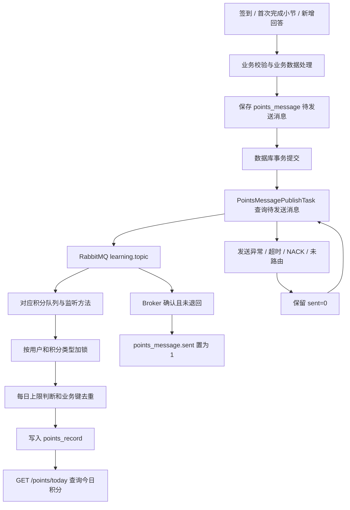

# 积分功能模块代码阅读报告

整理日期：2026-10-04。依据当前源码、Git 工作区差异、已保存的测试结果及本轮联调记录。

本轮改动主要解决五个后端问题：积分消息进入错误消费者、锁超时静默丢积分、签到位先写造成失败后无法重试、学习提交缺少真实小节校验
，以及业务提交后消息发送失败缺少恢复手段。后续又修复了“我的积分”页面的签到状态显示，并将前端新构建部署到实际访问的 Nginx 站点。

最主要的结构变化是：**学习完成、回答、签到先在数据库保存待发送积分消息，再由定时任务投递；消费端按原有积分规则入账，并使用业务键处理重复投递。**

## 1. 先理解模块里几类数据的区别

| 数据/组件 | 负责什么 | 阅读时要区分的含义 |
| --- | --- | --- |
| `learning_record`、回答记录 | 保存用户实际完成的业务动作 | 用户完成了什么 |
| Redis 月度签到 Bitmap | 查询每日签到状态、计算本月连续签到天数 | 哪些日期已签到 |
| 新增 `points_message` | 保存积分事件，记录是否确认投递到 RabbitMQ | 该事件有没有可靠地发送出去 |
| `points_record` | 保存最终获得的积分明细 | 用户实际加了多少分 |
| `PointsRecordType` | 定义积分分类和每日上限 | 每类积分允许获得多少 |
| `PointsBoard`、`PointsBoardSeason` 相关类 | 当前代码中的榜单、赛季基础结构 | 本轮没有扩展其业务实现 |

例如：回答正文已保存、积分消息也已保存，但消息尚未被消费时，用户的回答已经成功，积分明细可以稍后才出现。
`points_message.sent=1` 表示消息已获 Broker 确认且未被退回，**不等于消费端已经插入了积分明细**。

规则入口：[PointsRecordType.java](/D:/Java/tianji/tj-learning/src/main/java/com/tianji/learning/enums/PointsRecordType.java:13)。

| 类型 | 枚举值 | 监听器设置的单次积分 | 每日上限 |
| --- | --- | --- | --- |
| 课程学习 | `1` | `10` | `50` |
| 每日签到 | `2` | 基础 `1` 分，加连续签到奖励 | `0` 表示不设统一每日积分上限，签到自身限制每日一次 |
| 课程问答 | `3` | `5` | `20` |
| 课程笔记 | `4` | `3` | `20` |
| 课程评价 | `5` | `10` | `0` 表示不设统一每日积分上限 |

这里的分类、基础分值、上限判断和带业务键的积分去重逻辑，在本次五项修复前已存在。本轮主要修改它们周围的校验、消息可靠性和失败处理。

## 2. 修复后的业务链路



学习完成和新增回答的业务数据、消息记录在同一个数据库事务里提交。签到则先提交消息记录，再更新 Redis Bitmap，Redis 写入失败时由发布任务恢复。

## 3. 新增：数据库待发送消息机制

这部分是本轮新增代码最多、也最值得先理解的地方，通常称为“本地消息表”或 Outbox。

### 3.1 为什么需要消息表

原来的学习、回答链路采用 `afterCommit()`：数据库事务提交成功后，再调用 MQ 发送。它能够避免“业务回滚了，积分却已经发出”，
但还有一个缺口：**业务提交成功以后，进程退出或 MQ 发送失败，数据库里没有保留待发送事件。**

新增消息表后，业务成功时数据库里同时存在“发生了什么”和“需要发送什么”。发送失败不必重新执行用户的学习或回答操作，而是重试已保存的事件。

### 3.2 新增文件及作用

| 新增文件 | 主要内容 | 目的与作用 |
| --- | --- | --- |
| [PointsMessage.java](/D:/Java/tianji/tj-learning/src/main/java/com/tianji/learning/domain/po/PointsMessage.java:13) | 消息实体，映射 `points_message` | 用 PO 表达待发送积分事件 |
| [PointsMessageMapper.java](/D:/Java/tianji/tj-learning/src/main/java/com/tianji/learning/mapper/points/PointsMessageMapper.java:11) | 查询待发送消息、查询签到业务键、标记已发送 | 集中保存消息表访问逻辑 |
| [IPointsMessageService.java](/D:/Java/tianji/tj-learning/src/main/java/com/tianji/learning/service/points/IPointsMessageService.java:6) | `saveMessage()`、`querySignDates()` | 业务生产者通过统一接口保存事件、恢复签到记录 |
| [PointsMessageServiceImpl.java](/D:/Java/tianji/tj-learning/src/main/java/com/tianji/learning/service/points/impl/PointsMessageServiceImpl.java:24) | JSON 序列化、事务插入、签到日期解析 | 确保消息保存失败可以使对应数据库业务一起回滚 |
| [PointsMessagePublishTask.java](/D:/Java/tianji/tj-learning/src/main/java/com/tianji/learning/task/PointsMessagePublishTask.java:38) | 定时查询、发送、确认、恢复签到位 | 将消息投递从用户请求中移到可重试的后台任务 |
| [points-message.sql](/D:/Java/tianji/tj-learning/src/main/resources/db/points-message.sql:2) | 新建消息表，并兼容补齐积分幂等列和索引 | 提供新增代码需要的数据库结构 |

### 3.3 消息表字段为什么这样设计

| 字段 | 含义 | 作用 |
| --- | --- | --- |
| `id` | 自增消息记录编号 | 排序扫描、更新记录，也作为 AMQP `messageId` 和发送确认关联编号 |
| `message_key` | 稳定业务键，唯一 | 防止同一业务动作重复生成消息；签到还依靠它限制当天只能受理一次 |
| `routing_key` | 消息路由键 | 决定消息进入哪类积分队列 |
| `payload` | JSON 消息内容 | 重试时直接读取原事件，无需重新执行业务 |
| `sent` | 是否已确认发送 | `0` 表示待投递，`1` 表示已确认发送且未退回 |
| `create_time` | 记录创建时间 | 便于追踪和核对事件 |

`UNIQUE(message_key)` 约束业务键，`INDEX(sent,id)` 支持按待发送状态和编号扫描。

消息业务键采用以下格式：

```text
签到：sign:{userId}:{yyyy-MM-dd}
学习：learning:{lessonId}:{sectionId}
问答：qa:{replyId}
```

例如 `sign:2:2026-10-04`，不论请求并发多少次，数据库都只允许保留一条该业务键的记录。已发送记录继续保留，签到去重和本月签到恢复仍会用到这些键。

### 3.4 saveMessage() 的事务作用

方法新增了 `@Transactional(rollbackFor = Exception.class)`。默认事务传播行为会加入调用方已经开启的事务。

对学习、回答来说，业务服务原有的事务负责包住业务数据和消息记录；消息插入失败，整个数据库事务回滚。
对签到来说，调用方没有包住 Redis 的数据库事务，`saveMessage()` 自己完成消息插入和提交，然后签到服务才继续写 Bitmap。

Mapper 的三项查询/更新分别负责：

- `queryPendingMessages()`：查询 `sent=0`，按 `id` 排序，每批最多 `100` 条。
- `querySignKeys()`：按用户和 `yyyy-MM` 查询本月签到业务键，包含已发送和待发送记录。
- `markSent()`：条件更新 `WHERE id=? AND sent=0`，将已确认消息标记为已发送。

### 3.5 发布任务怎样做到可重试

`publishPendingMessages()` 使用 `@Scheduled(fixedDelay=1000)`，每轮执行结束后约一秒开始下一轮。
它是按批串行发送的，因此不能把“一秒调度间隔”理解为每条积分固定一秒到账。

每条消息的处理顺序是：

1. 若是签到消息，先按消息中的原始签到日期补回对应月份 Bitmap。
2. 构造 UTF-8 JSON、持久化 AMQP 消息，设置消息编号和请求追踪头。
3. 发送到 `learning.topic`，带上 `CorrelationData` 等待对应确认，单条最多等待五秒。
4. 只有 `confirm.isAck()` 为真、且没有 Returned Message，才调用 `markSent()`。
5. 发送异常、确认超时、NACK 或未路由时，保留 `sent=0`，后续扫描重试。

如果 MQ 已收到消息，但更新 `sent` 的数据库操作失败，下一轮可能再次发送。这是允许的：学习、问答、签到消费端使用业务键去重
，而不是要求消息传输绝不重复。

发布任务的分布式锁为 `lock:points:message-publish`，策略是 `SKIP_FAST`。这里跳过不会丢事件，
因为事件仍留在消息表里，正在运行的实例或下一轮任务可以继续处理。

### 3.6 修改 RabbitMQ 发布配置

[bootstrap.yml](/D:/Java/tianji/tj-learning/src/main/resources/bootstrap.yml:10) 新增：

```yaml
rabbitmq:
  publisher-confirm-type: correlated
  publisher-returns: true
  template:
    mandatory: true
```

`correlated` 让发布任务等待对应消息的 Broker 确认；`publisher-returns` 和 `mandatory` 让无法路由到队列的消息能够被识别。
否则，“发送到了交换机但没有进入队列”也可能被当作发送成功。

## 4. 修改：三类积分拆分队列

代码入口：[LearningPointsListener.java](/D:/Java/tianji/tj-learning/src/main/java/com/tianji/learning/mq/LearningPointsListener.java:57)。

原来学习、笔记、评价三个监听方法都绑定 `learning.points.queue`。
同一个队列上的消费者会竞争取消息，不会因为某个监听方法写了某个 routing key，就只给它分配该类型消息。
尤其学习消息是 `LearningPointsMessage`，笔记和评价消息是 `Long`，混用队列可能导致错误加分或反序列化失败。

本轮保留交换机和 routing key，修改队列名称：

| 业务 | routing key | 修改后的队列 |
| --- | --- | --- |
| 学习完成 | `section.learned` | `section.points.queue` |
| 新增笔记 | `note.new` | `note.points.queue` |
| 课程评价 | `comment.new` | `comment.points.queue` |
| 新增回答 | `reply.new` | 原有 `qa.points.queue` |
| 签到 | `sign.in` | 原有 `sign.points.queue` |

**作用：让消息在进入队列时就按业务分类，消费者处理的载荷与积分类型匹配。**

同时新增 [PointsMqConfig.java](/D:/Java/tianji/tj-learning/src/main/java/com/tianji/learning/config/PointsMqConfig.java:16)。它提供一个启动时执行的 `ApplicationRunner`，解除旧队列上学习、笔记、评价的三条绑定。

旧 RabbitMQ 绑定不会仅因 Java 注解改名而自动消失，所以需要显式解绑。这里解除绑定、保留旧队列及积压消息，
方便后续核对；代码没有自动删除历史消息。Broker 不可用时记录告警，恢复后重启服务完成解绑。

## 5. 修改：积分入账锁超时必须表现为失败

代码入口：[PointsRecordServiceImpl.java](/D:/Java/tianji/tj-learning/src/main/java/com/tianji/learning/service/points/impl/PointsRecordServiceImpl.java:31)。

两个 `addPointsRecord()` 重载的锁策略都从：

```java
LockStrategy.SKIP_AFTER_RETRY_TIMEOUT
```

改为：

```java
LockStrategy.FAIL_AFTER_RETRY_TIMEOUT
```

原策略拿不到锁时跳过方法、正常返回。对 MQ 消费者来说，正常返回通常代表处理成功，消息可能因此被确认，但积分尚未写入。

修改后锁超时抛异常，消费链路能够按失败流程处理并重试。修改两个入口，是为了同时覆盖带 `bizId` 和不带 `bizId` 的调用。

锁粒度仍是 `lock:points:{userId}:{type}`。同一用户、同一类型的“查询今日总分 → 判断上限 → 插入明细”需要串行执行
，避免并发请求同时看到相同总分而超过上限。

阅读这个类时，还要理解几项原有逻辑：

- 两个公开重载分别由 AOP 加锁，再调用私有 `doAddPointsRecord()`；这样避免公开方法自调用绕过代理。
- 达到每日上限就不再入账；剩余额度小于本次积分时，只入账剩余额度。
- `points_record` 的唯一约束 `(user_id,type,biz_id)` 用于挡住同一业务事件的重复入账，捕获 `DuplicateKeyException` 后忽略重复投递。
- 此处原有设计保持单条 INSERT 自动提交，锁释放时插入已经提交；本轮没有为消费端新加事务。

发布任务用 `SKIP_FAST`、入账方法用 `FAIL_AFTER_RETRY_TIMEOUT`，是因为两处跳过后的结果不同：
前者的待处理事件仍在数据库，后者正常返回可能结束一次 MQ 消费。

## 6. 修改：签到从“先写 Redis”改为“先保存可恢复的事件”

代码入口：[SignRecordServiceImpl.java](/D:/Java/tianji/tj-learning/src/main/java/com/tianji/learning/service/points/impl/SignRecordServiceImpl.java:36)。

### 6.1 原流程及问题

```text
setBit(今天, true) → 判断是否重复 → 计算积分 → 直接发送 MQ
```

Redis 写入成功、MQ 发送失败后，用户重试会得到“今日已签到”，而本次积分事件可能已经丢失。

### 6.2 修改后的流程

```text
从消息表恢复本月已受理签到位
→ getBit 查询今天是否签到
→ 计算本月连续天数和奖励
→ 保存唯一的 sign:{userId}:{date} 消息并提交
→ setBit 标记今天
→ 返回签到受理结果
→ 后台恢复签到位并投递积分事件
```

具体增删改及作用：

| 改动 | 目的与作用 |
| --- | --- |
| 依赖由 `RabbitMqHelper` 改为 `IPointsMessageService` | 签到请求先保存事件，不再直接承担 MQ 投递 |
| 原先读写合一的 `setBit()` 改成先 `getBit()` 检查 | 保存事件前不提前占用今天的签到状态 |
| 新增本月已受理签到日期恢复 | Redis 写入失败后，下一次签到计算仍能依据已保存事件恢复本月状态 |
| 新增消息业务键冲突处理 | 并发请求即使都读到“未签到”，数据库仍只允许一个受理成功 |
| 消息提交后再设置 Bitmap | 数据库消息保存失败时，不会留下“已签到但没有积分事件”的状态 |
| Bitmap 写入异常时记录日志并保留受理结果 | 事件已保存，发布任务可以补回签到位并继续发送 |
| 发布任务按消息原始日期生成 Redis 月份键 | 延迟重试跨月时，补写原签到月份，而不是错误地补到当前月份 |

### 6.3 为什么连续天数计算也需要调整

原来今天已经先写为 `1`，可以直接从今天向前统计。现在计算奖励时今天还没有写入，因此使用：

```java
int signDays = offset == 0 ? 1 : countSignDays(key, offset) + 1;
```

这里 `offset=dayOfMonth-1`，读取昨天及以前的位，统计连续天数，再加今天的一天。月初第一天直接返回 `1`。

连续签到仍按你确认的设计，**只统计本月**。奖励规则也是原有规则：

| 本月连续签到天数 | 额外奖励 | 当天实际积分 |
| --- | --- | --- |
| `7` | `10` | `11` |
| `14` | `20` | `21` |
| `28` | `40` | `41` |
| 其他 | `0` | `1` |

返回 VO 的 `rewardPoints` 是额外奖励；消息中的 `points` 是基础一分加奖励。

## 7. 修改：学习完成必须基于当前课程的真实小节

代码入口：[LearningRecordServiceImpl.java](/D:/Java/tianji/tj-learning/src/main/java/com/tianji/learning/service/lesson/impl/LearningRecordServiceImpl.java:75)。

### 7.1 新增 checkSection()

原有 `checkLesson()` 已校验课表存在、属于当前用户、未失效未过期。本轮在其后新增 [checkSection()](/D:/Java/tianji/tj-learning/src/main/java/com/tianji/learning/service/lesson/impl/LearningRecordServiceImpl.java:128)：

1. 调用 `courseClient.getCourseInfoById(courseId,true,false)` 获取当前课程及真实目录。
2. 遍历章节下的小节，寻找提交的 `sectionId`。
3. 找不到该小节就拒绝提交，避免用无关或不存在的 ID 产生完成记录。
4. 根据目录类型校验学习提交类型，避免把视频伪装成练习来走“提交即完成”分支。
5. 视频的 `duration` 使用目录中的 `mediaDuration`，覆盖客户端提交值。

两个系统的类型数值不同，代码显式做了对应：

| 目录类型 | 学习提交类型 |
| --- | --- |
| `2`：视频小节 | `SectionType.VIDEO`，值 `1` |
| `3`：练习小节 | `SectionType.EXAM`，值 `2` |

视频原有完成条件是 `moment * 2L >= duration`，也就是达到时长的一半。`moment` 来自播放进度提交，本轮让判定所用的总时长来自课程服务，防止通过缩短提交的 `duration` 提前达到条件。

这项校验使每次进度提交增加了一次课程目录查询；首次完成后，`handleLessonFinished()` 复用刚才得到的 `courseInfo`，删除原来为查询课程总小节数而单独发起的第二次远程查询。

### 7.2 完成后保存消息，替换 afterCommit 发送

首次完成小节后，原有课表更新与新消息保存处在 `addLearningRecord()` 的数据库事务里：

```java
handleLessonFinished(lesson, recordDTO, courseInfo);
pointsMessageService.saveMessage(
    "learning:" + lessonId + ":" + sectionId,
    MqConstants.Key.LEARN_SECTION,
    LearningPointsMessage.of(userId, lessonId, sectionId)
);
```

作用是让“学习完成状态、课表已学数量、待发送积分事件”共同提交。消息保存失败时，数据库业务回滚；MQ 暂时不可用时，已保存的事件等待后台重试。

已完成小节的回看分支原本就只更新播放进度，返回 `false`。所以不会再次更新课表已学数量，也不会再次生成积分事件。本轮联调中“播放正常但没有加分”的那次操作，数据库记录在 2026-09-16 已完成，属于这个分支；换成未完成小节后，你已确认验证成功。

## 8. 修改：回答正文与问答积分事件一起提交

代码入口：[InteractionReplyServiceImpl.saveReply()](/D:/Java/tianji/tj-learning/src/main/java/com/tianji/learning/service/interaction/impl/InteractionReplyServiceImpl.java:85)。

原来新增回答调用 `sendQaPointsAfterCommit()`，现在改为：

```java
pointsMessageService.saveMessage(
    "qa:" + reply.getId(),
    MqConstants.Key.WRITE_REPLY,
    ReplyPointsMessage.of(userId, reply.getId())
);
```

原有 `saveReply()` 事务负责包住正文、相关计数和新增积分消息。目的与学习链路相同：正文保存成功后，积分事件有持久化记录可以继续投递；消息保存失败时，正文也回滚。

原有业务分类保持为 `answerId == null` 时才发问答积分。对回答的评论不在这个方法里获得问答分。消费端沿用 `replyId` 作为积分 `bizId`，同一回答的消息重复投递不会重复入账。

## 9. 删除了哪些代码，为什么删除

本轮没有删除业务源文件，主要删除的是被新消息机制替代的发送代码及不用的依赖。

| 删除内容 | 原来负责什么 | 删除原因与替代方式 |
| --- | --- | --- |
| `LearningRecordServiceImpl.sendLearningPointsAfterCommit()` | 事务提交后直接发学习消息 | 由同事务 `saveMessage()` 和后台发布任务替代，补上发送失败后可恢复的事件记录 |
| `InteractionReplyServiceImpl.sendQaPointsAfterCommit()` | 事务提交后直接发回答消息 | 同上 |
| 上述两类中的 `TransactionSynchronization`、`TransactionSynchronizationManager` 导入 | 注册提交后回调 | 回调逻辑删除后不再使用 |
| 学习、回答、签到服务中的 `RabbitMqHelper` 字段和导入 | 用户业务流程直接投递 MQ | 生产者只保存消息，实际发送统一交给发布任务 |
| `handleLessonFinished()` 内重复的课程查询 | 单独取得课程总小节数 | 复用新增目录校验返回的 `courseInfo` |
| `SignRecordServiceImpl` 中未使用的 `DateTimeFormatter` 导入 | 无实际使用 | 清理修改涉及的无用导入 |
| 日历点击后立即执行 `val.isRecords=1` | 请求尚未成功就标成已签到 | 改为请求成功后由父组件更新状态 |

旧积分队列的三条绑定由启动配置移除，旧队列及历史积压保留；这和删除历史消息是不同的操作。

## 10. 数据库迁移为什么包含两张表的处理

[points-message.sql](/D:/Java/tianji/tj-learning/src/main/resources/db/points-message.sql:1) 做了两类事情：

- 新建 `points_message`，为生产者和发布任务提供持久化事件记录。
- 根据 `information_schema` 检查 `points_record.biz_id` 及 `(user_id,type,biz_id)` 唯一索引，缺失时补齐，存在时跳过。

消息表唯一键解决“同一业务动作不要重复生成待发送事件”；积分表唯一键解决“同一事件重复送达不要重复入账”。二者分别负责生产端和消费端。

学习事件的 `message_key` 包含课表和小节，最终积分 `bizId` 使用小节 ID；问答使用回答 ID；签到使用实际代码生成的 ISO 日期，例如 `2026-10-04`。

迁移兼容之前已手动完成幂等升级的数据库。已有重复业务键时，新增唯一索引会报错，脚本不会自动删除积分明细。你已在本轮执行迁移并重启 `learning-service`。

目前笔记、评价监听方法接收 `Long userId`，调用不带 `bizId` 的重载。本轮为它们拆分了队列和修正锁超时处理；新增本地消息表的业务接入集中在学习、回答、签到三条链路。

## 11. 前端修改：已签到状态、提交状态和成功状态分别处理

文件位于另一个前端工作区 `D:\Java\tj-protal`：

- [Calendar.vue](/D:/Java/tj-protal/src/pages/personal/components/Calendar.vue:13)
- [myIntegral.vue](/D:/Java/tj-protal/src/pages/personal/myIntegral.vue:125)

### 11.1 修正接口数据读取

你提供的实际接口响应为：

```json
{
  "code": 200,
  "msg": "OK",
  "data": {
    "signDays": 2,
    "signRecords": [1, 0, 1, 1]
  }
}
```

日历原来写的是 `signData.value=res.data`，之后却用数组下标读取 `signData.value[i-startDayWeek]`。由于 `res.data` 是对象，当天状态会读成 `undefined`，自然走到“打卡”分支。

现在读取 `res.data.signRecords`。数组角标 `0` 表示当月一号，因此 `[1,0,1,1]` 表示一号、三号、四号已签到；四号进入页面应直接显示“已打卡”。

### 11.2 请求成功之后才显示已打卡

之前子组件点击后先 `emit()`，立即把 `val.isRecords` 改为 `1`，即使后续请求失败也显示已打卡。

现在的协作方式是：

1. 子组件判断已经签到或正在提交时直接返回。
2. 将当天条目的 `signing` 设为 `true`，显示“打卡中…”，再把该条目传给父组件。
3. 父组件调用 POST 签到接口，只有 `code==200` 才执行 `item.isRecords=1`。
4. `finally()` 将 `item.signing=false`；业务失败和网络失败都不会误标为已打卡。
5. 查询或提交失败提示改为对应的签到提示，替换原来误写的“学霸榜请求失败”。

### 11.3 积分列表里已有的展示修改

签到按钮修复之前，`myIntegral.vue` 的工作区里已经存在：直接用 `/points/today` 的返回列表渲染，以及将 `maxPoints<=0` 显示为“不限”的改动。本轮保留了这些代码，并随当前前端工作区构建部署。

它们让实际积分和上限来自后端，避免前端写死签到上限等数据与服务端规则不一致。阅读 Git diff 时，需要把这些已有改动与本轮新增的签到状态修复区分开。

## 12. 为什么源码修复后还需要部署前端

你实际访问的是 `http://www.tianji.com/#/personal/main/myIntegral`。该域名通过 Nginx 提供静态构建，站点目录为 `/usr/local/src/nginx/html/tj-portal`，不是本地 Vite 开发服务。

因此本地 `.vue` 文件修改后，刷新服务器站点仍会加载旧构建。排查确认，旧积分资源 `myIntegral.88537a04.js` 不含 `signRecords` 修复。

经你确认“部署并验证”后，已经完成：

- 用当前前端工作区执行 Vite development 模式构建，接口仍指向 `http://api.tianji.com`。
- 部署前备份站点到 `/usr/local/src/nginx/html/tj-portal-backup-20261004-122411-cb21a2be`。
- 先复制新资源，最后替换入口 HTML，并保留旧资源供已打开页面使用。
- 新入口为 `index.e621097c.js`，新积分资源为 `myIntegral.a89d4c2e.js`。
- 通过实际域名核验 HTML、入口 JS、积分页面 JS 均返回 HTTP 200，内容与新构建一致。

部署过程中遇到的 Windows 换行问题已经修正后重试成功。这是部署脚本格式处理，不是额外的积分业务规则修改。

## 13. 新增测试和验证依据

后端新增四个测试类，共 `27` 个用例：

| 测试类 | 用例数 | 保护的行为 |
| --- | --- | --- |
| [PointsFlowRegressionTest](/D:/Java/tianji/tj-learning/src/test/java/com/tianji/learning/service/points/PointsFlowRegressionTest.java:49) | `10` | 队列隔离、旧绑定清理、真实锁切面超时抛错、签到先落消息再写位、并发唯一键、签到位恢复 |
| [LearningPointsValidationTest](/D:/Java/tianji/tj-learning/src/test/java/com/tianji/learning/service/lesson/LearningPointsValidationTest.java:87) | `6` | 任意小节拒绝、视频伪装练习拒绝、目录缺失拒绝、服务端时长、合法视频完成、合法练习提交 |
| [PointsMessagePublishTaskTest](/D:/Java/tianji/tj-learning/src/test/java/com/tianji/learning/task/PointsMessagePublishTaskTest.java:29) | `4` | 发送失败后重试、NACK/未路由保留待发送、原月份 Bitmap 恢复、已发送标记失败后的重复投递 |
| [PointsMessageTransactionTest](/D:/Java/tianji/tj-learning/src/test/java/com/tianji/learning/service/points/PointsMessageTransactionTest.java:81) | `7` | 业务和消息共同回滚、提交前其他连接不可见、发布后业务键仍唯一、本月签到查询、回答生产者事务、消费端上限与去重 |

`pom.xml` 新增 H2 的 `test` 依赖，用于隔离数据库事务与唯一键测试。生产数据库仍使用原配置。事务测试使用真实 Spring 事务和 MyBatis 消息 Mapper；回答业务 Mapper 部分通过 mock 配合测试写入模拟业务表，因此不能把它理解为完整生产数据库的端到端测试。

原有 `ReplyExistenceHttpTest` 五个用例、`ReplyLikeRegressionTest` 三个用例一起执行。后者仅更新了构造参数注释，以反映 `mqHelper` 改成 `pointsMessageService`。

保存的 Maven 测试结果是：**35 个用例，0 失败、0 错误、0 跳过，BUILD SUCCESS**，完成时间为 2026-10-03 22:58。本次报告整理重新核对了 Surefire 报告，没有重新执行整套测试。

前端验证包括复现原接口对象被当数组读取的问题、页面重新进入时恢复已签到、提交期间阻止重复点击、成功后更新状态、业务失败和网络失败后保留未签到状态，以及两个 Vue 文件的脚本和模板编译。完整 Vite 构建成功。

联调方面：签到、回答的积分入账已查日志和数据库；首次完成小节的链路由你操作后确认验证成功。前端部署已核对线上资源；部署后的登录页面最终显示仍需与用户浏览器结果区分，不能用静态文件 HTTP 200 代替真实页面验收。

## 14. 推荐阅读顺序

建议先沿着一条链路看完整，再横向比较另外两条生产链路：

1. `PointsRecordType` → `PointsRecord`：认识积分类型、上限和最终明细字段。
2. `SignRecordController` → `SignRecordServiceImpl.addSignRecords()`：认识 Bitmap、月度连续签到和奖励。
3. `PointsMessage` → `PointsMessageMapper` → `PointsMessageServiceImpl`：理解事件如何进入数据库及事务边界。
4. `PointsMessagePublishTask` → `bootstrap.yml`：理解何时发送、什么才算发送成功、失败怎么重试。
5. `LearningPointsListener` → `PointsRecordServiceImpl`：理解消息类型对应队列，最终如何加锁、限额、去重和入账。
6. `LearningRecordServiceImpl`、`InteractionReplyServiceImpl`：比较学习和回答怎样生成积分事件，重点看同事务保存。
7. `SignRecordServiceImpl.querySignRecords()` → `Calendar.vue` → `myIntegral.vue`：理解签到查询响应、日期数组和按钮状态。
8. 四个新增测试类：结合失败场景理解每项修改为什么必要。

读完后应能区分三个问题：业务有没有完成、消息有没有可靠投递、积分有没有实际入账。它们分别由业务记录、消息表状态和积分明细证明。
